# awesome-adelmonte

Software I've built for Linux and Android, mostly in Rust.

## Contents

- [Android](#android)
- [Desktop apps](#desktop-apps)
- [Desktop components](#desktop-components)
- [Games](#games)
- [System](#system)
- [Terminal](#terminal)
- [Other](#other)
- [Older](#older)

## Android

### [lanlink-android](https://github.com/adelmonte/lanlink-android)

The phone side of [lanlink](https://github.com/adelmonte/lanlink), a small KDE Connect
alternative. Plain Kotlin on the Android SDK, with no AndroidX or Compose.

- Send files, text and links to a computer, from the app or the share sheet
- Media controls for whatever plays on the computer, and a touchpad and keyboard for it
- Lets the computer browse the phone's storage

<picture><source media="(prefers-color-scheme: dark)" srcset="badges/lanlink-android-dark.svg"></picture>

Install the APK from the [Releases](https://github.com/adelmonte/lanlink-android/releases) page

### [music-android](https://github.com/adelmonte/music-android)

The Android companion to [music-tui](https://github.com/adelmonte/music-tui): your music,
Spotify playlists, internet radio and podcasts in one app, built with Material 3 Expressive.

- Search, charts, recommendations and song radios; anything you play is saved as a tagged file
- About 50,000 radio stations and a podcast player that remembers where you stopped
- Spotify playlists imported from Exportify or linked to stay in step

<picture><source media="(prefers-color-scheme: dark)" srcset="badges/music-android-dark.svg"></picture>

Install the APK from the [Releases](https://github.com/adelmonte/music-android/releases) page

### [victoria-launcher](https://github.com/adelmonte/victoria-launcher)

A minimal, list-based Android home screen and an open source alternative to Niagara Launcher.

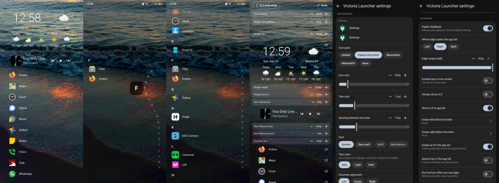

- Swipe in from either edge for the A-Z list, and slide along the letters to jump
- Rename apps, change icons, hide them or file them in folders
- Every gap, height and margin adjustable, with search over all the settings

<picture><source media="(prefers-color-scheme: dark)" srcset="badges/victoria-launcher-dark.svg"></picture>

Install from [F-Droid](https://f-droid.org/packages/dev.victorialauncher/) or the APK on the [Releases](https://github.com/adelmonte/victoria-launcher/releases) page

## Desktop apps

### [document-viewer](https://github.com/adelmonte/document-viewer)

A document viewer for PDF, DjVu, DVI, TIFF, images and comic books, in pure Rust.

- No GTK, Qt, glib, cairo or poppler
- PDFs rendered with hayro, DjVu with djvu-rs
- egui interface

<picture><source media="(prefers-color-scheme: dark)" srcset="badges/document-viewer-dark.svg"></picture>

Install with the PKGBUILD in the repo

### [image-view](https://github.com/adelmonte/image-view)

A minimal, keyboard-driven image viewer: an egui port of qView. No GTK, no Qt.

- qView's behavior, settings and shortcuts
- Color management with lcms2
- Wayland or X11

<picture><source media="(prefers-color-scheme: dark)" srcset="badges/image-view-dark.svg"></picture>

Install from the AUR: [`image-view`](https://aur.archlinux.org/packages/image-view)

### [langis-gui](https://github.com/adelmonte/langis-gui)

Signal Desktop, 1:1, in native Rust. No Electron. Built with egui on
[langis](https://github.com/adelmonte/langis), a Signal client library. Unofficial.

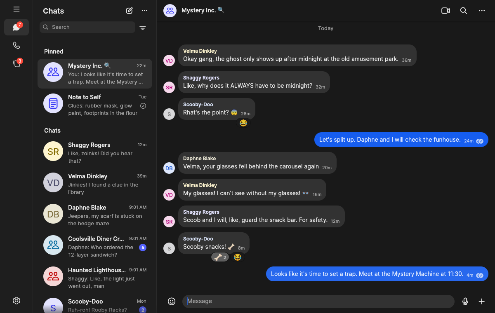

- Same layout, colors, fonts, icons and menus as Signal Desktop
- Links to your phone as a secondary device
- Chats, groups, calls, stories, reactions, polls, voice messages and stickers

<picture><source media="(prefers-color-scheme: dark)" srcset="badges/langis-gui-dark.svg"></picture>

Install from the AUR: [`langis-gui`](https://aur.archlinux.org/packages/langis-gui)

## Desktop components

### [emoji-picker-rs](https://github.com/adelmonte/emoji-picker-rs)

A GTK4 emoji picker for Wayland. A rewrite of [emoji.py](https://github.com/adelmonte/emoji.py) that opens noticeably faster.

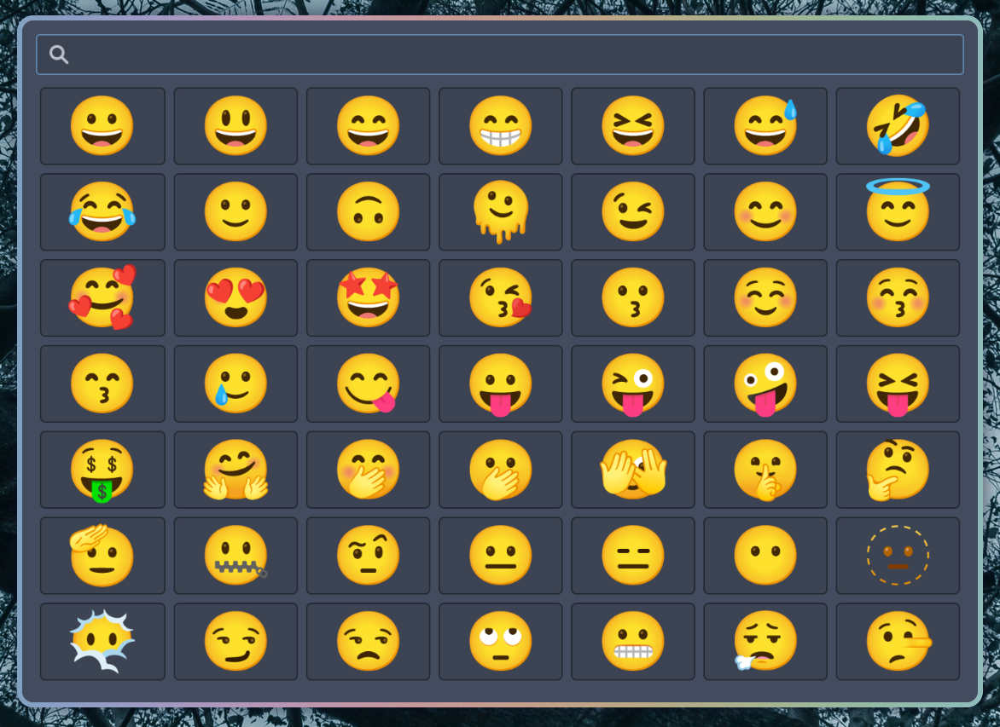

- Search by typing, click to insert
- Types the emoji with wtype, or copies it with wl-copy
- First frame in about 120 ms from a keybind

<picture><source media="(prefers-color-scheme: dark)" srcset="badges/emoji-picker-rs-dark.svg"></picture>

Install from the repo

### [launcher](https://github.com/adelmonte/launcher)

An application launcher for Waybar, replacing Xfce's Whisker Menu.

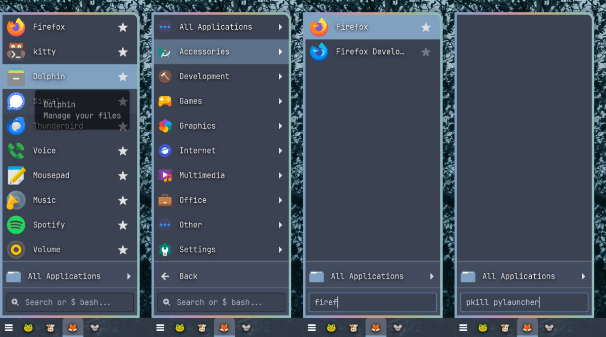

- Starred favorites, reordered by dragging
- Categories, search and full keyboard navigation
- Runs anything that isn't an app as a command; daemon mode toggles instantly

<picture><source media="(prefers-color-scheme: dark)" srcset="badges/launcher-dark.svg"></picture>

Install from the repo

### [niri_window_buttons](https://github.com/adelmonte/niri_window_buttons)

A Waybar module with traditional window buttons for niri.

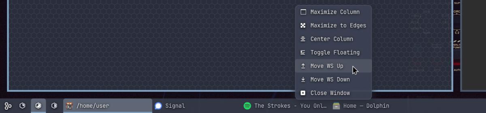

- App icons and titles, with configurable click actions and a context menu
- Per-app rules, window filtering and multi-select
- Drag and drop reordering, multi-monitor support

<picture><source media="(prefers-color-scheme: dark)" srcset="badges/niri_window_buttons-dark.svg"></picture>

Install from the AUR: [`niri_window_buttons`](https://aur.archlinux.org/packages/niri_window_buttons)

### [niri_workspaces](https://github.com/adelmonte/niri_workspaces)

A Waybar module for niri workspaces, with pie chart icons showing how many windows each one has.

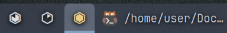

- Custom format strings and icons by workspace state and name
- Click to switch, drag and drop to reorder
- Multi-monitor support and CSS styling by state

<picture><source media="(prefers-color-scheme: dark)" srcset="badges/niri_workspaces-dark.svg"></picture>

Install from the repo

### [notification-daemon](https://github.com/adelmonte/notification-daemon)

A notification daemon and notification center for Wayland, and a lighter replacement for
SwayNotificationCenter. No GTK and no GPU context.

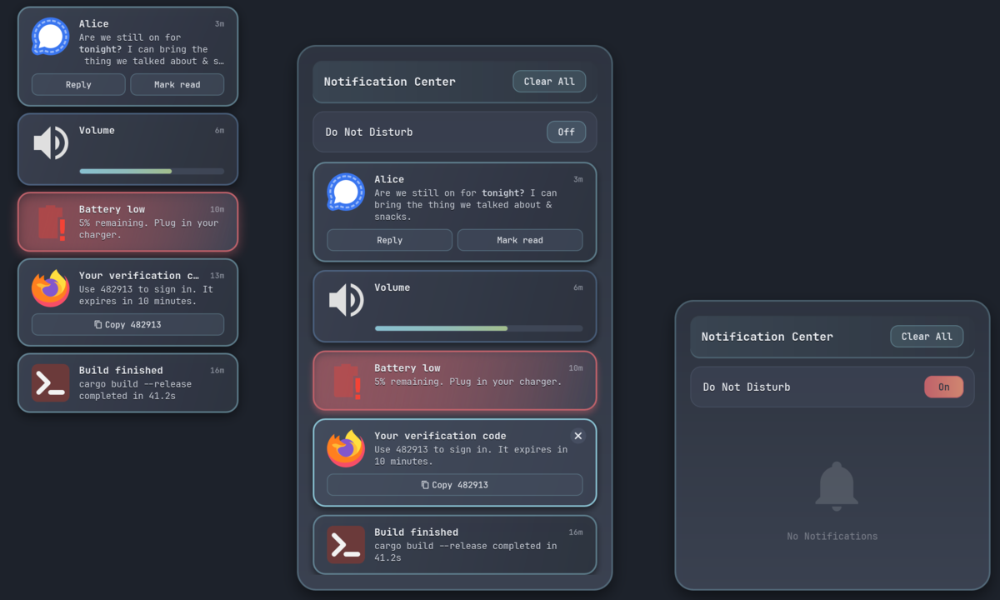

- Popups with icons, images, progress bars and action buttons; a center with history and Do Not Disturb
- A one-click Copy button on verification codes
- Rules, hooks, sounds and a Waybar module

<picture><source media="(prefers-color-scheme: dark)" srcset="badges/notification-daemon-dark.svg"></picture>

Install with the PKGBUILD in the repo

### [simplecal](https://github.com/adelmonte/simplecal)

A small popup calendar for Wayland bars, replacing gsimplecal without GTK.

- Month grid with month and year pickers, wheel and keyboard navigation
- Running it again closes it, so one bar button toggles it
- Every font, size and color themeable from a TOML file

<picture><source media="(prefers-color-scheme: dark)" srcset="badges/simplecal-dark.svg"></picture>

Install with the PKGBUILD in the repo

### [text_expander](https://github.com/adelmonte/text_expander)

A text expander for Wayland and a lighter replacement for espanso. It reads espanso config files.

- Simple triggers, variables and shell commands
- Works with keyd and kmonad setups
- No root needed, only the input group

<picture><source media="(prefers-color-scheme: dark)" srcset="badges/text_expander-dark.svg"></picture>

Install from the AUR: [`text_expander`](https://aur.archlinux.org/packages/text_expander)

### [xdg-desktop-portal-plain](https://github.com/adelmonte/xdg-desktop-portal-plain)

An xdg-desktop-portal backend for niri without GTK: everything xdg-desktop-portal-gtk does,
plus screen sharing.

- Settings (dark mode, accent color, themes and fonts for sandboxed apps), AppChooser, notifications and inhibit
- Screen sharing through niri
- File dialogs come from a separate backend such as [xdg-desktop-portal-tui](https://github.com/adelmonte/xdg-desktop-portal-tui)

<picture><source media="(prefers-color-scheme: dark)" srcset="badges/xdg-desktop-portal-plain-dark.svg"></picture>

Install with the PKGBUILD in the repo

## Games

### [hearts-rs](https://github.com/adelmonte/hearts-rs)

Windows 95 style Hearts, built the same way as solitaire-rs. A rewrite of qt-hearts.

- Three computer players at Easy, Medium or Hard, ported from qt-hearts
- Passing, shooting the moon and the usual rules
- About 3.4 MB, no X11 or XWayland

<picture><source media="(prefers-color-scheme: dark)" srcset="badges/hearts-rs-dark.svg"></picture>

Install from the AUR: [`hearts-rs`](https://aur.archlinux.org/packages/hearts-rs)

### [kpat-win95](https://github.com/adelmonte/kpat-win95)

A KPatience fork with the Windows 95 raining cards win animation and user-controlled card size.

- Cards launch, bounce and leave trails like Windows 95 Solitaire
- Survives window resizes; one click dismisses it
- Changes live on the `win95` branch

<picture><source media="(prefers-color-scheme: dark)" srcset="badges/kpat-win95-dark.svg"></picture>

Install with the PKGBUILD in the repo

### [qt-hearts](https://github.com/adelmonte/qt-hearts)

Classic Hearts built with Qt6.

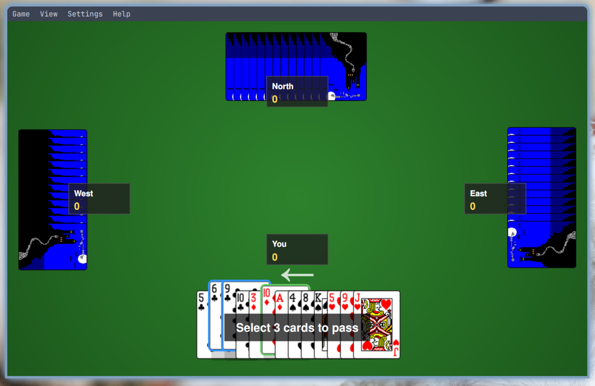

- Three computer players at three difficulty levels
- Undo, sound effects and statistics
- KDE card decks

<picture><source media="(prefers-color-scheme: dark)" srcset="badges/qt-hearts-dark.svg"></picture>

Install from the AUR: [`qt-hearts`](https://aur.archlinux.org/packages/qt-hearts)

### [solitaire-rs](https://github.com/adelmonte/solitaire-rs)

Windows 95 style Klondike solitaire as one static native Wayland binary, with no shared libraries.

- KPatience's rules and deal numbers
- Works with KDE card decks
- About 3.3 MB, no X11 or XWayland

<picture><source media="(prefers-color-scheme: dark)" srcset="badges/solitaire-rs-dark.svg"></picture>

Install from the AUR: [`solitaire-rs`](https://aur.archlinux.org/packages/solitaire-rs)

## System

### [arch-native](https://github.com/adelmonte/arch-native)

Rebuilds your installed packages from source with compiler flags tuned for your CPU, signs
them and serves them as a pacman repo. A helper then swaps your installed packages for the
optimized builds.

```
$ sudo native-sync
native-sync: 853 / 1197  (71%)
native-sync: patches  41 ok, 2 review, 1 fail
```

- A build daemon for the build host, and a client for each machine using the packages
- Per-package patches and choice of what gets built
- Works on any pacman-based distro

<picture><source media="(prefers-color-scheme: dark)" srcset="badges/arch-native-dark.svg"></picture>

Install from the AUR: [`arch-native`](https://aur.archlinux.org/packages/arch-native), [`arch-native-client`](https://aur.archlinux.org/packages/arch-native-client)

### [Auto Adaptive Backlight](https://github.com/adelmonte/Auto_Adaptive_Backlight)

Adjusts a laptop's screen brightness from its ambient light sensor.

```sh
ls /sys/bus/iio/devices/      # iio:device0 or similar means a sensor is there
sudo systemctl enable --now auto-brightness.timer
```

- Reads the sensor through IIO
- Runs as a systemd service and timer

<picture><source media="(prefers-color-scheme: dark)" srcset="badges/Auto_Adaptive_Backlight-dark.svg"></picture>

Install from the repo

### [hdas](https://github.com/adelmonte/hdas)

Tracks which packages create files in your home directory, so you can clean up what a
package left behind after you uninstall it.

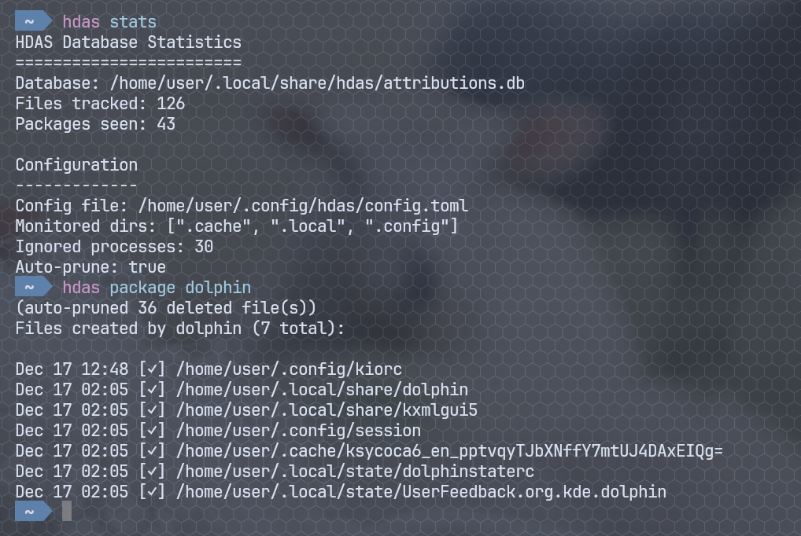

- eBPF tracing of file operations, attributed through the process tree to a package
- pacman, portage, dpkg, rpm, xbps and apk, plus Flatpak, Snap, Nix, Guix and AppImage
- Orphan detection and safe cleanup with dry runs

<picture><source media="(prefers-color-scheme: dark)" srcset="badges/hdas-dark.svg"></picture>

Install from the AUR: [`hdas`](https://aur.archlinux.org/packages/hdas)

### [Network-Aware Firewall](https://github.com/adelmonte/Network_Aware_Firewall)

An nftables firewall that switches between home and public rules on its own, through a
NetworkManager dispatcher hook.

```
fw status          # current firewall mode and network
fw trust           # add the current network to the trusted list
fw home / public   # apply a rule set by hand
```

- Boots with the public rules; trusted networks get the home rules
- Every switch is logged to the journal
- No dependencies beyond nftables and NetworkManager

<picture><source media="(prefers-color-scheme: dark)" srcset="badges/Network_Aware_Firewall-dark.svg"></picture>

Install from the repo

### [pkgbuild-audit](https://github.com/adelmonte/pkgbuild-audit)

A security scanner for PKGBUILDs that lists what it finds and leaves the decision to you,
with no trust score and no automatic blocking. A fork of
[Sohimaster/traur](https://github.com/Sohimaster/traur).

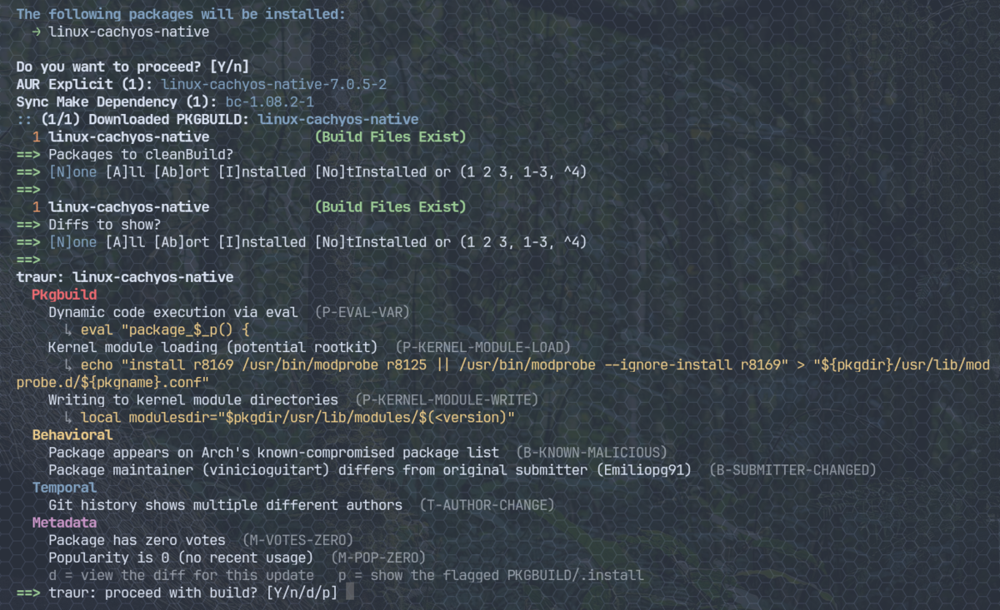

- Checks PKGBUILDs, .install scripts, source URLs, AUR metadata and git history
- Wraps makepkg so every AUR build through yay or paru is scanned first
- Works on any PKGBUILD: AUR, ABS or your own

<picture><source media="(prefers-color-scheme: dark)" srcset="badges/pkgbuild-audit-dark.svg"></picture>

Install with the PKGBUILD in the repo

### [ukigen](https://github.com/adelmonte/ukigen)

Builds unified kernel images and initramfs images. One binary does the work of ukify/eukify
and booster, with the same flags and the same output, plus its own initramfs init and UEFI stub.

```sh
ukigen                 # every installed kernel: initramfs + UKI straight onto the ESP
ukigen list            # what it would build, and where
eukify build ...       # symlink: byte-identical output to ukify
booster build ...      # symlink: byte-identical images to booster 0.13
```

- Initramfs + UKI written to the ESP in about 0.2 s
- The init is 1.5 MB instead of booster's 18 MB
- LUKS, LVM and mdraid built in; TPM, FIDO2, SSH unlock, plymouth and more are optional features

<picture><source media="(prefers-color-scheme: dark)" srcset="badges/ukigen-dark.svg"></picture>

Install from the AUR: [`ukigen`](https://aur.archlinux.org/packages/ukigen)

## Terminal

### [audio-tui](https://github.com/adelmonte/audio-tui)

A mixer and control panel for PipeWire. It covers what pavucontrol does, plus device
renaming, virtual devices, sample rate and WirePlumber's per-app memory.

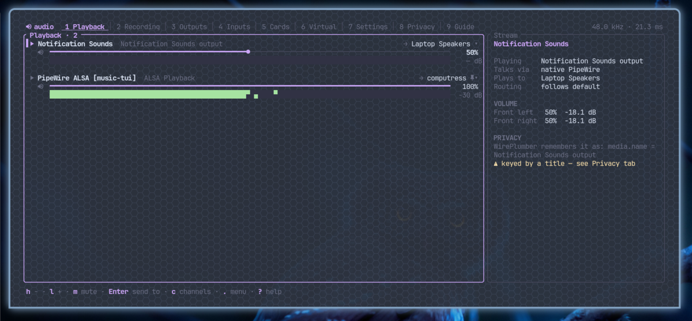

- Volume, mute and routing for apps, outputs and inputs, with live level meters
- Card profiles, including Bluetooth codecs
- Virtual devices: combined output, loopback, echo cancellation, noise suppression, equalizer

<picture><source media="(prefers-color-scheme: dark)" srcset="badges/audio-tui-dark.svg"></picture>

Install with the PKGBUILD in the repo

### [bluetooth-tui](https://github.com/adelmonte/bluetooth-tui)

A Bluetooth manager for BlueZ.

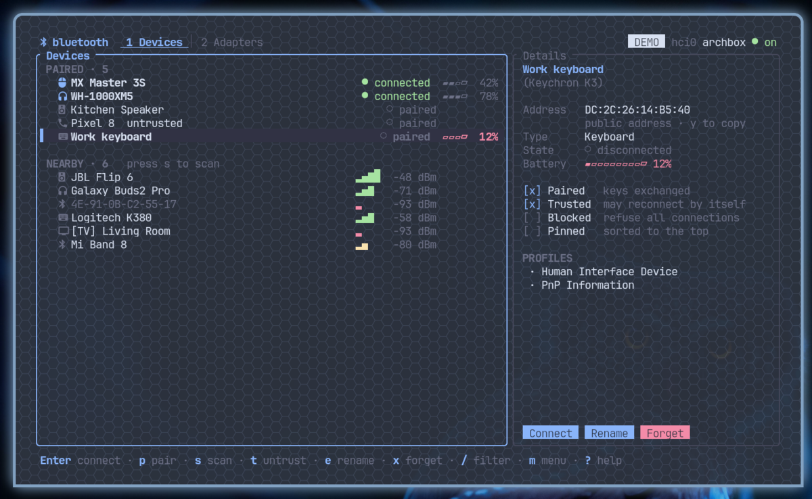

- Paired and nearby devices in one list, with battery level and signal strength
- Pair, connect, trust, block, rename and forget devices
- Built-in pairing agent; event-driven over D-Bus, nothing polls

<picture><source media="(prefers-color-scheme: dark)" srcset="badges/bluetooth-tui-dark.svg"></picture>

Install with the PKGBUILD in the repo

### [file-browser-tui](https://github.com/adelmonte/file-browser-tui)

A Dolphin-like file manager for [kitty](https://sw.kovidgoyal.net/kitty/), with real
thumbnails and your icon theme drawn through kitty's graphics.

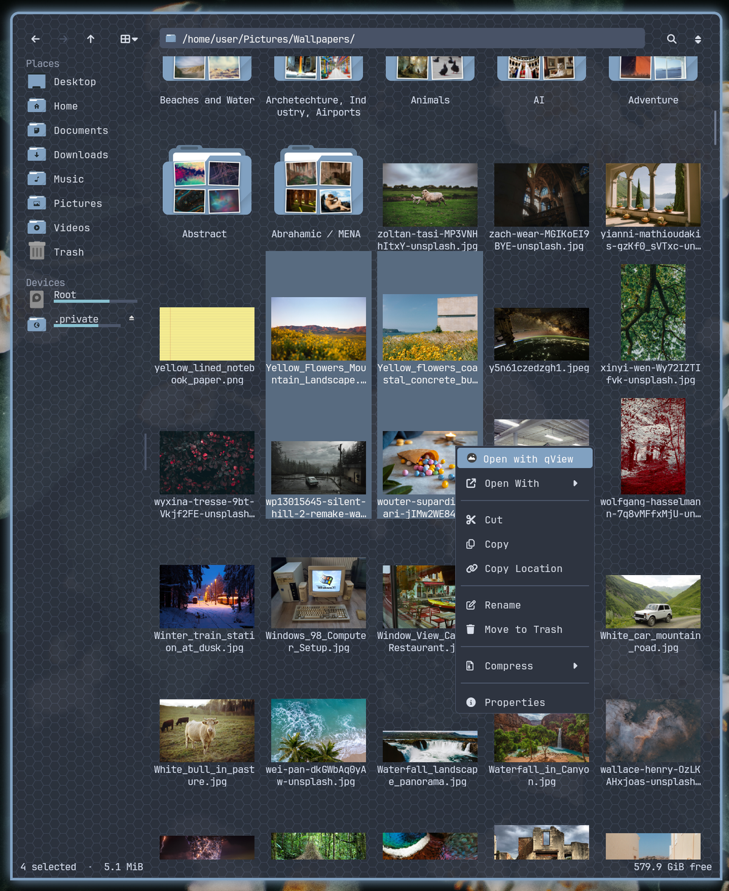

- Icons, Compact and Details views, tabs and split view, a places sidebar
- Click, drag, box-select and right-click menus; every action also has a shortcut
- With [xdg-desktop-portal-tui](https://github.com/adelmonte/xdg-desktop-portal-tui), it is also the Open and Save dialog for Firefox and other programs

<picture><source media="(prefers-color-scheme: dark)" srcset="badges/file-browser-tui-dark.svg"></picture>

Install from the AUR: [`file-browser-tui`](https://aur.archlinux.org/packages/file-browser-tui), [`xdg-desktop-portal-tui`](https://aur.archlinux.org/packages/xdg-desktop-portal-tui)

### [lanlink](https://github.com/adelmonte/lanlink)

A small KDE Connect alternative: a daemon and a TUI in one binary, with no KDE or GNOME
libraries. It speaks the KDE Connect protocol, so it pairs with the
[lanlink Android app](https://github.com/adelmonte/lanlink-android), the stock KDE Connect
app and other machines running lanlink.

- Files, links and text both ways, and the clipboard on request
- Browse the phone's storage over sshfs; the phone controls desktop media players
- Remote mouse and keyboard in either direction, on any compositor or X11

<picture><source media="(prefers-color-scheme: dark)" srcset="badges/lanlink-dark.svg"></picture>

Install from the AUR: [`lanlink`](https://aur.archlinux.org/packages/lanlink)

### [music-tui](https://github.com/adelmonte/music-tui)

A music player for a local library, with album art in kitty.

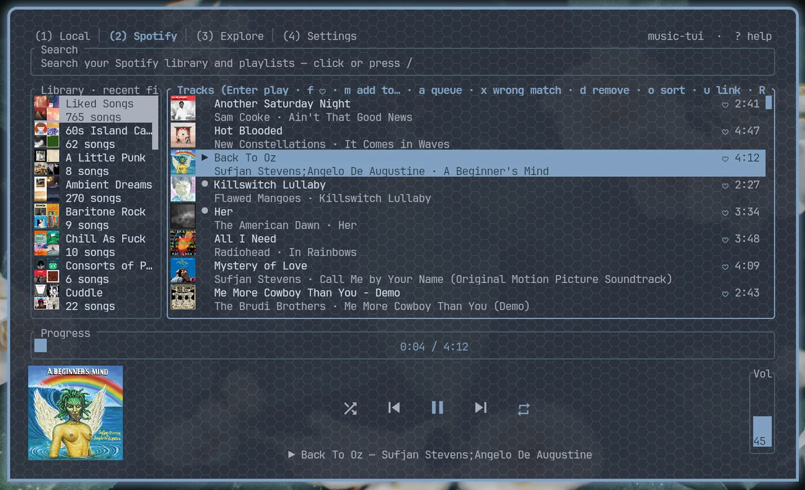

- Album artist / album / track browser, queue, playlists and gapless crossfade
- Optional Spotify library import and Explore tab, streamed through YouTube with no accounts
- Companions: [music-android](https://github.com/adelmonte/music-android) and [music-kodi](https://github.com/adelmonte/music-kodi)

<picture><source media="(prefers-color-scheme: dark)" srcset="badges/music-tui-dark.svg"></picture>

Install from the AUR: [`music-tui`](https://aur.archlinux.org/packages/music-tui)

### [network-tui](https://github.com/adelmonte/network-tui)

A NetworkManager client. It covers what nmtui does, with a keyboard and mouse interface.

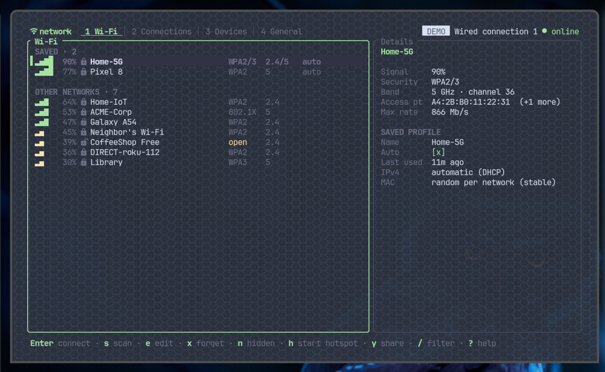

- Wi-Fi scanning, hidden networks, hotspot and QR code sharing
- Ethernet, WireGuard, VPN, VLAN, bridge and bond connections, with a full connection editor
- Built-in password agent; works with the iwd backend

<picture><source media="(prefers-color-scheme: dark)" srcset="badges/network-tui-dark.svg"></picture>

Install with the PKGBUILD in the repo

### [Simple Package Manager](https://github.com/adelmonte/Simple_Package_Manager)

An fzf interface for pacman and yay: browse, search and select packages with live previews.

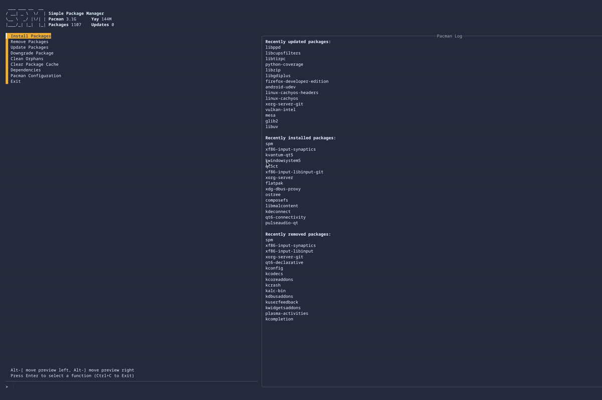

- Install, remove, update and downgrade (through the Arch Linux Archive)
- Orphans, dependencies, cache, ALPM hooks and .pacnew/.pacsave files
- pacman.conf and repository settings without a text editor

<picture><source media="(prefers-color-scheme: dark)" srcset="badges/Simple_Package_Manager-dark.svg"></picture>

Install from the AUR: [`spm-arch`](https://aur.archlinux.org/packages/spm-arch)

## Other

### [langis](https://github.com/adelmonte/langis)

A Signal client library in Rust with no UI, and the backend of
[langis-gui](https://github.com/adelmonte/langis-gui). Unofficial.

- Linking, messaging, groups, attachments, calls and sync, in an encrypted store
- Bring your own interface: egui, GTK, Qt, a TUI or a bot
- Follows Signal Desktop's behavior, with 578 tests

<picture><source media="(prefers-color-scheme: dark)" srcset="badges/langis-dark.svg"></picture>

Install as a Cargo dependency from the repo

### [llm-cli](https://github.com/adelmonte/llm_cli)

Chat with LLMs through any OpenAI-compatible API, and let them run commands after you confirm.

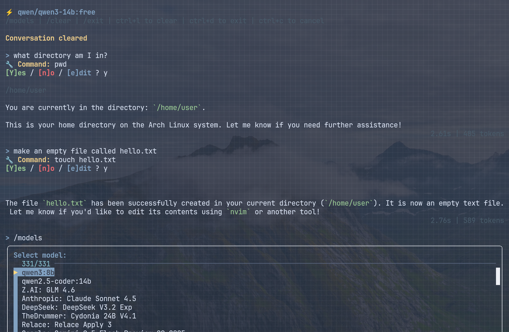

- Markdown rendering with bat, mdcat or rich
- Switch models on the fly with fzf
- Knows the date, distro, shell and editor

<picture><source media="(prefers-color-scheme: dark)" srcset="badges/llm_cli-dark.svg"></picture>

Install from the repo

### [music-kodi](https://github.com/adelmonte/music-kodi)

The Kodi add-on companion to [music-tui](https://github.com/adelmonte/music-tui): stream any
song, play your Spotify likes and playlists, and listen to radio and podcasts in Kodi.

- Charts, recommendations, song radios and search
- About 50,000 radio stations and podcast subscriptions
- Context menus on every song: like, add to playlist, song radio, go to artist or album

<picture><source media="(prefers-color-scheme: dark)" srcset="badges/music-kodi-dark.svg"></picture>

Install the zip from the [Releases](https://github.com/adelmonte/music-kodi/releases) page through Kodi's Install from zip file

## Older

Earlier versions, kept for reference:

- [emoji.py](https://github.com/adelmonte/emoji.py): a Python emoji picker. Replaced by emoji-picker-rs.
- [evince-rs](https://github.com/adelmonte/evince-rs): a Rust + GTK3 port of Evince. Replaced by document-viewer.
- [g-view](https://github.com/adelmonte/g-view): a Rust + GTK3 port of qView. Replaced by image-view.
- [Weather-Widget](https://github.com/adelmonte/Weather-Widget): a three-day forecast for the Xfce panel.
- [x11_shake_to_magnify_cursor](https://github.com/adelmonte/x11_shake_to_magnify_cursor): shake the mouse to make the cursor big, for X11.
